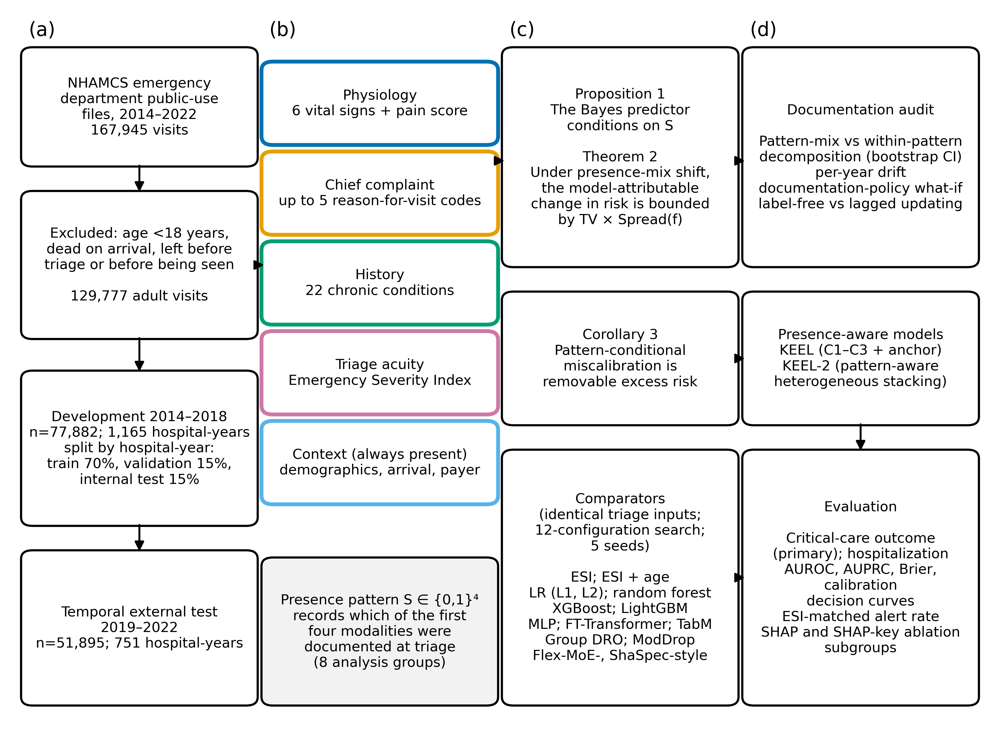
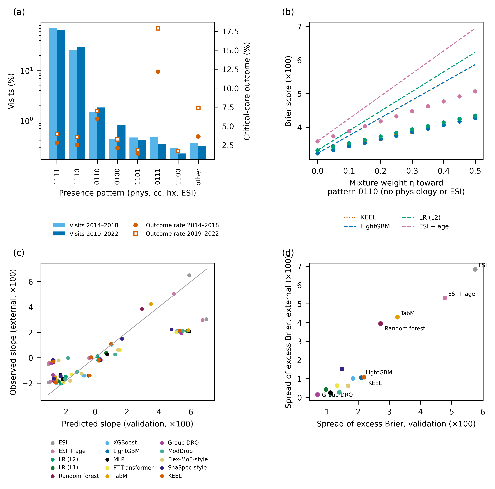
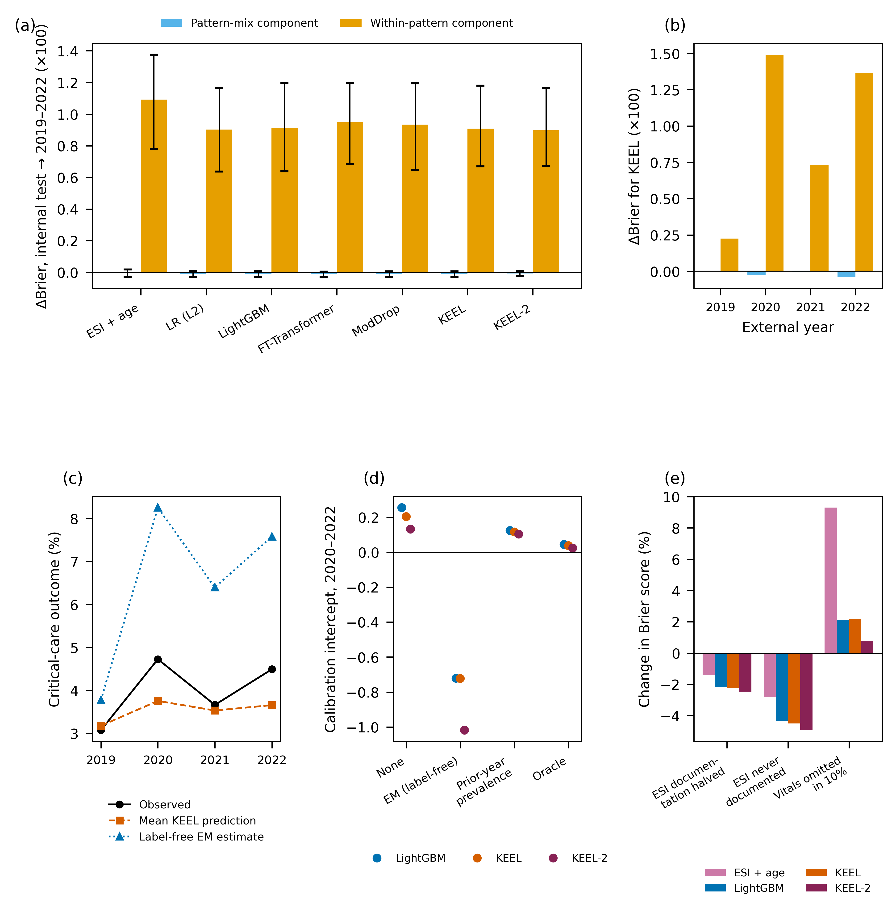
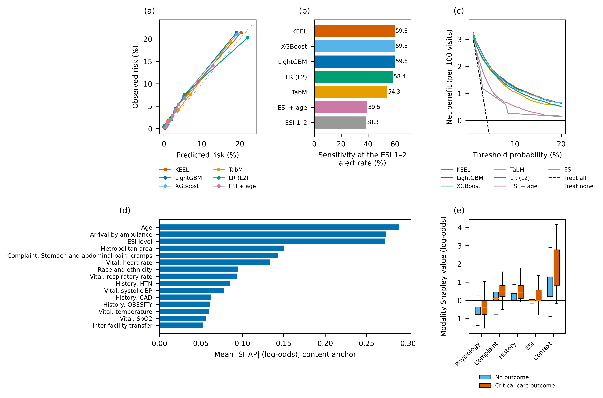

# Auditing Documentation Patterns and Temporal Drift in Machine-Learning Triage

## Overview

Triage models can degrade because patient risk changes, because documentation practices change, or because performance changes within the same documentation pattern. These mechanisms require different responses.

This study develops a framework that decomposes temporal change in prediction error into:

1. a **pattern-mix component**, caused by changes in how often each documentation pattern occurs; and
2. a **within-pattern component**, caused by changes in patients or model performance inside those patterns.

The audit was evaluated using **129,777 adult emergency-department visits** from NHAMCS, with models developed in 2014–2018 and tested in 2019–2022.

> This public repository contains a study overview and selected main figures. Code, data, manuscripts, supplementary material, and full tables remain private.

## Study design

Documentation patterns were defined across physiology, chief complaint, chronic history, and ESI. Sixteen models were audited, including gradient boosting, neural tabular models, multimodal fusion approaches, and two presence-aware models, KEEL and KEEL-2.

The outcome was a critical-care composite. Evaluation included discrimination, calibration, Brier score, clinical utility, subgroup analysis, and updating strategies.

## Presence-pattern theory

Documentation was prognostic. In 2019–2022, visits without recorded physiology had a 7.3% critical-care outcome rate versus 4.0% under full documentation. The theory predicted degradation under shifts toward particular patterns, and predicted versus observed degradation slopes correlated strongly:

- Pearson **r=0.861** for Brier score;
- Pearson **r=0.787** for log loss;
- Spearman **ρ=0.921** between validation and external worst-pattern spread.

## Main findings

| Temporal external test | Estimate |
|---|---:|
| Visits / critical outcomes | 51,895 / 2,044 |
| KEEL AUROC | **0.861** (95% CI 0.853–0.869) |
| KEEL-2 AUROC | 0.862 (95% CI 0.854–0.870) |
| LightGBM AUROC | 0.860 (95% CI 0.853–0.868) |
| ESI AUROC | 0.698 |
| KEEL sensitivity at similar ESI alert volume | **59.8%** |
| ESI sensitivity | 38.3% |

Presence-aware models performed similarly to LightGBM rather than clearly surpassing it. Their main role in the study was to support explicit auditing across documentation patterns.

For KEEL, the increase in Brier score from the internal test to 2019–2022 was driven almost entirely by the **within-pattern component** (0.908×10⁻²; 95% CI 0.670–1.179). The pattern-mix component was negligible (−0.011×10⁻²; 95% CI −0.028–0.006). The same qualitative result held across the audited models.

Label-free prevalence correction worsened calibration because the inputs changed along with prevalence. Updating with the previous year's observed prevalence reduced the calibration intercept from 0.204 to 0.117 and ECE from 0.007 to 0.005.

At comparable alert rates, KEEL identified 59.8% of critical outcomes versus 38.3% for ESI, with 441 fewer missed outcomes in the test sample. LightGBM performed identically. Learned models had greater net benefit than ESI over threshold probabilities from 2% to 20%.

## Interpretation

A change in the proportion of documented modalities was not the main cause of temporal degradation in this cohort. Most drift occurred within the same documentation patterns, and a simple update using recent labeled prevalence improved calibration. The findings caution against assuming that label-free prevalence estimation is safe when the covariate distribution also shifts.

## Limitations

- The analysis used a national survey rather than a live deployment.
- Documentation patterns captured whether a modality was present, not every aspect of measurement quality.
- Some policy-shift analyses were simulated.
- Updating results depend on access to recent labeled outcome prevalence.

## Repository scope

Only `README.md` and four selected main figures are public. This repository is a research overview and not a clinical decision-support implementation.
